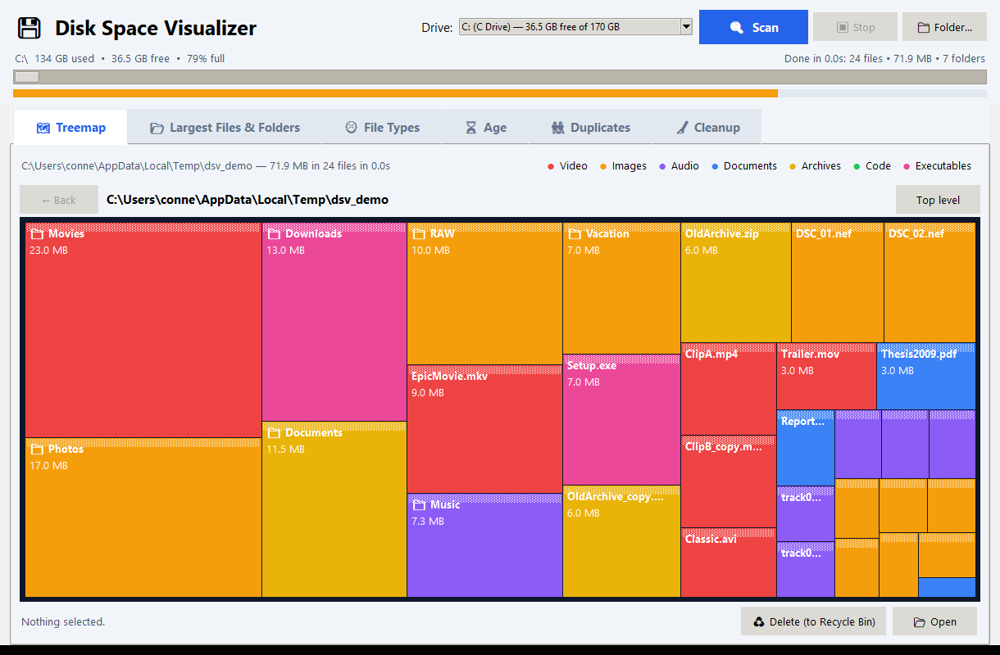
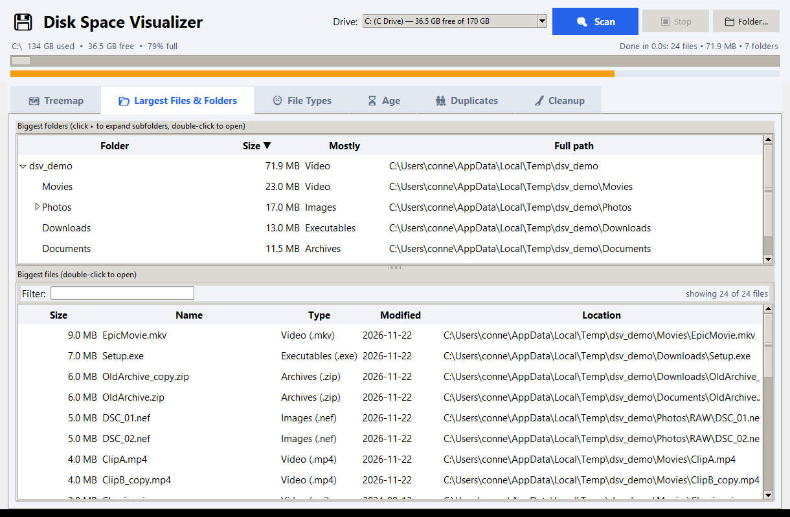
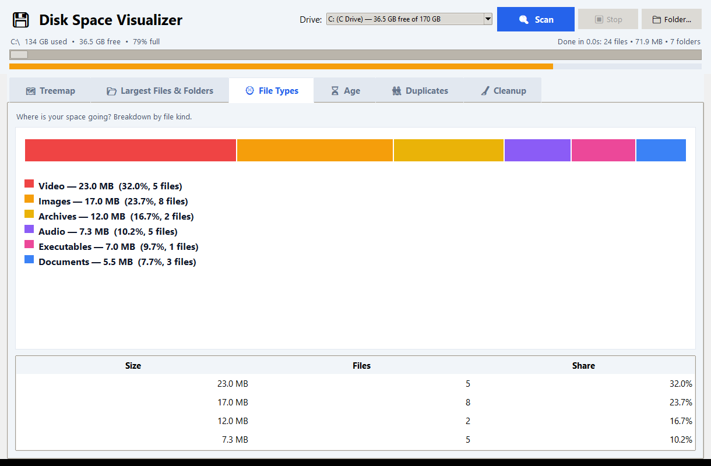
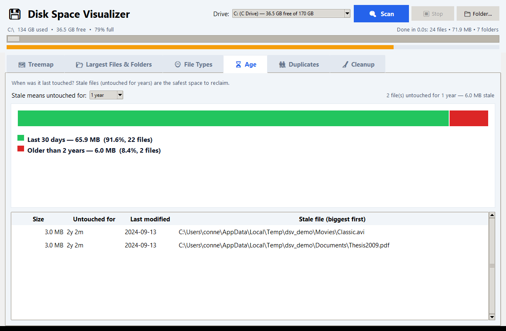
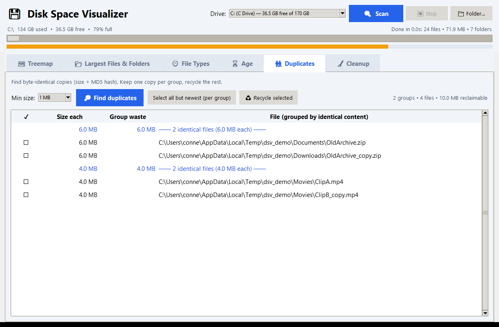
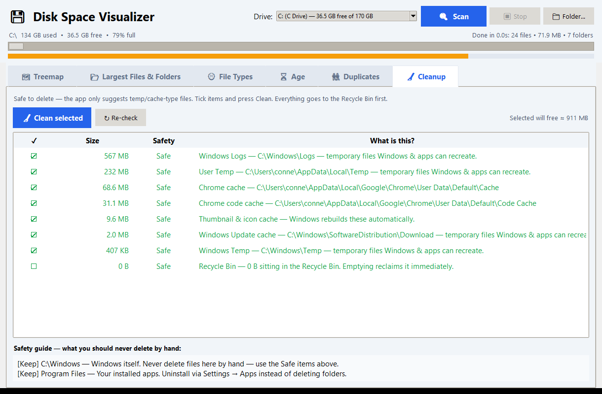

<p align="center">
  
</p>

<h1 align="center">💾 Disk Space Visualizer</h1>

<p align="center">
  <b>See what's eating your disk — and safely clean it up.</b><br/>
  Free, offline disk analyzer for Windows. No installs, no cloud, no telemetry.
</p>

<p align="center">
  
  
  
  
  
  
</p>

<p align="center">
  <a href="#-download">⬇️ Download .exe</a> •
  <a href="#-quick-start">Quick start</a> •
  <a href="#-features">Features</a> •
  <a href="#%EF%B8%8F-build-a-exe">Build</a> •
  <a href="#-safety">Safety</a>
</p>

---

## ⬇️ Download

> **Get the ready-to-run app from GitHub Releases — no Python needed.**

1. Go to 👉 **[Releases](../../releases)** → latest `v1.2.0`
2. Download **`DiskSpaceVisualizer.exe`** (~13 MB, portable)
3. Double-click to run. That's it.

No installer, no admin rights, no dependencies. Copy it to a USB stick if you like.

## ✨ Features

| Tab | What you see |
|-----|--------------|
| 🗺 **Treemap** | Every big folder/file as a coloured block. Bigger block = more space. Click a folder to drill in, click a block for details, right-click to open / recycle. |
| 📂 **Largest Files & Folders** | Sortable Top-300 folders (expandable tree) + Top files table with live search filter. Double-click to open, right-click → Open / Show in Explorer / Recycle. |
| 🥧 **File Types** | Stacked bar + table — Video vs Images vs Documents vs … Instantly see *what kind* of data fills the disk. |
| ⏳ **Age** | Green → red heatmap of last-modified age. Lists biggest files untouched for 6 mo / 1 yr / 2 yrs — forgotten data is the safest to reclaim. |
| 👯 **Duplicates** | Byte-identical copies via size + MD5 (partial → full hash). Grouped view, "keep newest" auto-select, recycle the rest, total waste counter. |
| 🧹 **Cleanup** | One-click **safe-to-delete** list: Temp files, Windows Update cache, browser caches, thumbnail cache, Recycle Bin, giant forgotten Downloads. Everything goes to the **Recycle Bin first** (undoable). |

Also: drive usage bar (green → amber → red), live scan progress, cancel anytime, custom-folder scan, protected-folder warnings (Windows / Program Files).

## 📸 Screenshots

Screenshots live in [`docs/screenshots/`](docs/screenshots/) (generated from a real scan):

| Treemap | Files | Types |
|---|---|---|
|  |  |  |
| **Age** | **Duplicates** | **Cleanup** |
|  |  |  |

> Screenshots not showing? They are generated locally (never committed as fakes). Run this to regenerate them:
>
> ```bat
> pip install pillow
> python capture_shots.py
> REM outputs to %TEMP%\dsv_shots\shot_*.png -> copy into docs\screenshots\
> ```

## 🚀 Quick start

Requires **Windows + Python 3.10+**. Zero third-party packages.

```bat
git clone https://github.com/thecloudtalks/DiskSpaceVisualizer.git
cd DiskSpaceVisualizer
python main.py
REM ...or just double-click run.bat
```

No `pip install` needed — standard library only (`tkinter`, `os`, `ctypes`).

## ⚡ Live preview while editing the UI

Don't rebuild the exe to preview frontend changes — run from source, it's the identical UI and refreshes in ~2 seconds:

```bat
dev.bat        :: auto-restarts the app every time you save a .py file
```

| Script | Output | Build | Start | Use for |
|--------|--------|-------|-------|---------|
| `dev.bat` | — (runs source) | instant | ~2 s | everyday UI iteration ✅ |
| `build_exe_dev.bat` | `dist\DiskSpaceVisualizer-dev\` | ~1 min | instant | testing the packaged exe |
| `build_exe.bat` | `dist\DiskSpaceVisualizer.exe` | ~4 min | ~5 s unpack | release / sharing |

## 📦 Build a `.exe` (one file, no Python needed)

Double-click **`build_exe.bat`**. It installs PyInstaller once, then produces **`dist\DiskSpaceVisualizer.exe`** (~13 MB, portable). The `app.ico` icon is embedded automatically. If Inno Setup 6 is installed, it also compiles a full Setup wizard into `installer-output\`.

Manual equivalent:

```bat
pip install pyinstaller
pyinstaller --noconsole --onefile --name DiskSpaceVisualizer --icon app.ico --add-data "app.ico;." --add-data "app.png;." main.py
iscc installer.iss   :: optional Setup wizard
```

## 💻 Install it (optional)

No install required — the exe is portable. If you want shortcuts:

| Method | How | Admin? |
|--------|-----|--------|
| Portable | `install.bat` → copies to `%LocalAppData%`, Start Menu + Desktop shortcuts (`uninstall.bat` removes) | No |
| Setup wizard | Compile `installer.iss` with Inno Setup 6 → `DiskSpaceVisualizer-Setup-1.2.0.exe` | Per-user (lowest) |

## 🧠 How it works

```
main.py ─▶ app.py (Tkinter UI, 6 tabs)
             ├─ scanner.py        — background os.scandir walk, skips junctions,
             │                      aggregates folder sizes bottom-up, progress queue
             ├─ treemap_canvas.py — squarified treemap layout on tk.Canvas
             ├─ analyzer.py       — file-type + age breakdowns, safe-cleanup recommendations
             ├─ duplicates.py    — size → partial-MD5 → full-MD5 grouping, threaded
             ├─ cleaner.py        — SHFileOperationW (Recycle Bin), SHEmptyRecycleBinW
             ├─ utils.py          — drives via GetLogicalDrives, categories, formatting
             ├─ app.png           — the icon (canonical source; window/taskbar)
             ├─ app.ico           — multi-size exe icon, rebuilt from app.png via build_icon.py
             └─ build_icon.py     — regenerates app.ico from app.png (needs Pillow, build-time only)
```

* **Fast:** single daemon thread + `os.scandir`, ~100k files in seconds, UI never freezes.
* **Safe:** cleaner only touches temp/cache locations + your explicit selections; protected paths (`C:\Windows`, `Program Files`) trigger an extra warning.
* **Undoable:** deletes use `FOF_ALLOWUNDO` → files land in the Recycle Bin.

## 🛡 Safety levels

| Badge | Meaning |
|-------|---------|
| 🟢 **Safe** | Temp / cache / Recycle Bin — OS & apps recreate these. Always fine to clear. |
| 🟡 **Caution** | Large Downloads etc. — tick only files you recognise. The app asks again. |
| 🔴 **Keep** | Windows, Program Files, your documents — listed only as guidance, never auto-deleted. |

Deleting files is always at your own risk; when in doubt, back up first.

## 🗺 Roadmap

- [ ] Export HTML/PDF storage report
- [ ] Scheduled auto-clean of temp files
- [ ] Dark mode
- [ ] Portable settings file

PRs and issues welcome!

## 🤝 Contributing

1. Fork → `git checkout -b feat/my-idea`
2. `python main.py` to test (`dev.bat` for auto-reload)
3. Commit → push → open a PR

Please keep it stdlib-only so the app stays zero-dependency.

## 📄 License

MIT — see [LICENSE](LICENSE). Do what you like, no warranty.

---

<p align="center">
  Made with ❤️ in Python + Tkinter ·  Disk Space Visualizer v1.2.0
</p>
